# ELYTRA

一个基于 **EML Lib** 的个人自用 Minecraft 启动器。Electron + React + TypeScript，界面以简洁、易读为主：深色红黑、浅色白蓝、跟随系统；减少渐变、圆角与装饰性英文。

> ELYTRA 有两条启动路径：**本地直接启动**用于已经下载好的 PCL / 官方版本，不下载、不校验、不重新安装；**ELYTRA 安装模式**由 EML 在独立目录中安装与校验。ELYTRA 负责实例管理、PCL 适配、Mod 文件管理、外观、资源下载、崩溃分析和界面；认证、皮肤、整合包清单安装由 EML 承担。

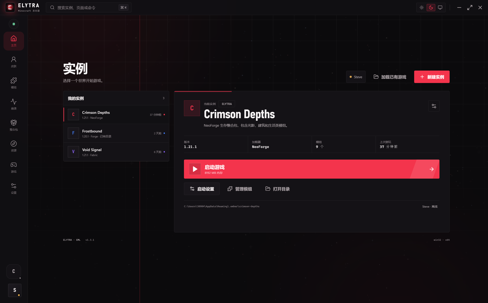

## 功能

- **两种启动模式（自动 / 手动）**：
  - **本地直接启动**：直接执行原版本 JSON 的 mainClass 与 JVM 参数，游戏目录设为 PCL 的版本隔离目录。不会下载、覆盖或重新安装任何文件，不需要等待 EML 安装。
  - **ELYTRA 安装模式**：由 EML 在 `.ember/<slug>` 独立目录安装 Minecraft、加载器、资源与 Java。不会写入 `.minecraft`。
  - 实例设置 → 基础 → 启动方式可切换 `自动 / 本地直接启动 / ELYTRA 安装`。
- **多实例 / 多版本**：每个实例独立 `gameDir`、`mods`、`config`、`saves`。
- **加载已有游戏（PCL 适配）**：扫描官方 `.minecraft`、ELYTRA 与自定义目录下的 `versions/`，读取 PCL 的 `PCL/Setup.ini`：
  - 识别 `VersionArgumentIndieV2`，按 PCL 的版本隔离规则把游戏目录设为 `versions/<version-id>`；
  - 从 PCL 合并后的版本 JSON 读取 mainClass、libraries、JVM 参数、natives、assets index；
  - 自动读取 PCL 检测到的 Java（包括 Microsoft Store 运行时），按版本要求选择 Java；
  - 加载后**直接启动**，不下载、不安装。原有 Mod、配置、存档照常生效。
  - 缺少客户端 JAR 的版本会在导入列表中标记为「缺少 JAR」并禁止直接启动。
- **版本设置**：版本 / 加载器、内存上下限、Java 自动或手动、窗口尺寸、全屏、启动后行为、JVM 参数、游戏附加参数、实例目录。
- **创建实例时配置加载器**：Vanilla、Forge、NeoForge、Fabric、Quilt。版本列表来自 Mojang / 各加载器 Meta。
  - NeoForge 元数据优先从 QLU / BMCLAPI 镜像读取，官方 Maven 不可达时仍能列出并下载加载器。
  - Forge 安装器改为按 `1.20.1-47.4.28` 的完整 Maven 坐标请求，修复此前 `meta.json` 404 和缺少版本 JSON、无法下载游戏的问题。
- **多线程下载 + 智能镜像（默认开启）**：
  - 默认 16 个并发下载线程，可在全局设置中调整为 4–32；下载过程中根据实时吞吐在范围内动态增减。
  - 官方、BMCLAPI、QLU 镜像同时参与测速；大文件（>1.5 MB）先做 Range 测速再选源，官方超时或明显偏慢时自动切换镜像。
  - 单个源超过 12 秒仍没有足够数据会被放弃；失败/哈希错误的源会被降权。提供 SHA-1 的文件会在完成后校验，再原子替换目标文件。
  - EML 的 NeoForge `.sha1` 缺失问题已兼容，加载器可以正常下载。
- **统一游戏设置**：
  - 画面、声音、控制（含键位捕获）、界面与聊天、原始选项五个分类；原始选项可编辑任意 `options.txt` 键。
  - 保存模板**不会修改已有版本**；只会在新建实例、新下载游戏、新加载已有游戏时自动合并。
  - 已有版本必须点击「应用到已有版本」并勾选后才会写入；写入前会备份原 `options.txt`。
  - 支持视场角（界面显示 30–110°，写入 options.txt 的 -1–1 归一值）、渲染/模拟距离、帧率、画质、云、粒子、亮度、音量、鼠标灵敏度、常见键位、语言、聊天、皮肤部件等；其余键走原始选项。
- **账户与退出登录**：Microsoft、Yggdrasil / Drasl、离线账户；账户面板中可以直接退出当前登录。
- **3D 皮肤工坊与披风**：`skinview3d` 实时预览，支持待机 / 行走 / 奔跑 / 飞行动画、旋转、缩放、皮肤上传、披风切换与隐藏。离线账户会显示示例皮肤并明确提示限制。
  - **万用皮肤补丁 LocalSkin**：当前实例的 `mods/` 中存在 `CustomSkinLoader*.jar` 时自动切换本地模式，皮肤读取 `CustomSkinLoader/LocalSkin/skins`，披风读取 `CustomSkinLoader/LocalSkin/capes`。
  - **集中外观库**：所有皮肤与披风放在 `%APPDATA%/ELYTRA/appearance/skins|capes`，可批量导入、打开文件夹、直接点选应用；当前实例已有的 LocalSkin 文件也会出现在列表里。
  - **没有补丁时**：检测不到 `CustomSkinLoader*.jar` 时，外观页会提供「安装万用皮肤补丁」按钮，通过 Modrinth 自动下载匹配当前加载器与游戏版本的补丁；安装后即可在启动器选择本地皮肤与披风。Vanilla 实例无法加载补丁时会明确提示。
- **启动器外观**：深色 / 浅色 / 跟随系统；新增**按时间切换**，可自定义浅色开始时间和深色开始时间，支持跨午夜。
- **个性化**：强调色、背景强度（克制/标准/浓郁）、界面动效开关；强调色应用到按钮、选中态和高光。
- **动效**：新的电影感启动页（双帘开幕、逐字 Logo、光束和扫光）、页面淡入位移、极光与 Python 生成尘埃、指针视差、骨架屏、聚光卡片和数字滚动；支持 `prefers-reduced-motion`。
- **启动控制**：启动过程中可点「取消启动」；游戏运行时可点击右上角「游戏运行中」或启动面板里的「停止游戏」结束 Java 进程；启动页缩短等待时间。
- **实例快捷方式**：实例设置 → 目录页可创建桌面 `.lnk`，快捷方式携带 `--instance` + `--launch`：先打开 ELYTRA，再自动启动该实例。
- **内置模组库**：模组页「模组库」支持导入本地 `.jar` 或从网络 `.jar` 直链导入；一键复制到当前实例 `mods/`，禁用时只删除实例副本，库中原件保留。
- **导出**：实例设置 → 目录页支持：
  - 选择单个或多个存档导出为 ZIP；
  - 导出包含启动器版本、实例、Minecraft 版本、加载器、时间、启用/禁用模组列表的 TXT；
  - 导出 **CurseForge `manifest.json`**（`manifestType: minecraftModpack`），并额外包含 `elytraFiles` 完整模组数据（文件名、名称、版本、大小、SHA-1）；
  - 导出 **Modrinth `index` JSON**，包含可追踪模组的完整下载数据；
  - 导出完整整合包 ZIP：`manifest.json` + `modlist.html` + 无法映射 CurseForge ID 的模组放进 `overrides/mods/`；
  - 保存对话框会记住上一次导出的目录。
- **Modrinth 资源面板**：只使用公开 API（无需 Key）搜索模组、光影、材质包。
  - 筛选项：内容类型、加载器、游戏版本、发布渠道（release / beta / alpha）；加载器与游戏版本从 Modrinth 标签接口动态读取。
  - 游戏版本显示正式 / 快照类型，文件版本显示 release / beta / alpha；点击项目先读取 `/project/{id}/version`，再从 `files[].url` 下载。
  - 目标目录：模组 → `mods/`，光影 → `shaderpacks/`，材质包 → `resourcepacks/`。
  - 更新检测：记录通过面板下载的项目 ID 与版本，检查新版本时区分游戏版本类型与发布渠道；发现更新后右下角出现提示、模组导航出现红点，模组列表显示「可更新」，支持单个或一键更新。
  - 下载（含更新）使用多线程 Range 分片；默认 32 线程，滑条最大 64、输入框最大 128；顶部右侧会持续显示当前文件名、百分比、已下载大小、速度和线程数。
  - 下载限速默认关闭，可设为 1–20 MB/s，限制启动器全部下载的总速度。
- **本地 Mod 管理**：扫描当前实例实际游戏目录下的 `mods/` 与 `mods-disabled/`。PCL 版本隔离实例会读取 `versions/<id>/mods/`，不再误读 `.minecraft/mods/`。解析 Fabric / Quilt / Forge / NeoForge 元数据、提取图标、启用 / 禁用（移动文件）、拖动排序、重复 ID 与损坏 JAR 警告。
- **崩溃分析**：首屏直接显示「最可能原因」和「先做这几步」，再用“诊断 / 可疑代码 / 资源检查 / 日志”分页查看。日志同样从 PCL 版本隔离目录读取。
  - 会自动读取 `logs/` 下的 `latest.log`、`*.log.gz` 历史归档和崩溃报告，提取 ERROR / Exception / HARD_DEP / Mod resolution 等错误行，参与同一次分析。
  - 能识别 Fabric 的 `HARD_DEP` 依赖解析错误，直接给出缺失前置（例如 fabric-api）和版本范围。
  - **最近分析会保存**：最近 12 次结论持久化到配置，切换页面或重启启动器后仍可回看。
  - 快速判定：OOM、Java 版本、重复 Mod、缺失依赖、Mixin、图形驱动、损坏 JAR、退出码等。
  - 堆栈嫌疑犯：跳过 Minecraft / 加载器 / Mixin 框架 / JDK 帧，报告第一个第三方帧与来源 JAR。
  - 完整性：版本 JSON、客户端 JAR、assets、Mod 可读性、重复 ID、Java、内存、磁盘。
- **整合包导入**：支持 EML 兼容清单、**CurseForge `manifest.json`**（projectID/fileID）以及本启动器导出的 **`elytraFiles` 元数据清单**。
  - ELYTRA 导出的 JSON 没有下载地址；导入会创建实例并保存 `.elytra-restore.json` 待恢复列表，可从完整 ZIP 的 `overrides/mods/`、清单同目录或模组库补齐文件。
  - CurseForge 文件通过公开项目索引解析为 `mediafilez.forgecdn.net` 直链，按项目类型放入 `mods/`、`resourcepacks/` 或 `shaderpacks/`；遇到 403 时自动尝试 `edge.forgecdn.net` 并补充浏览器 User-Agent / Referer。
  - 自动识别 `minecraft.modLoaders`（如 `fabric-0.19.5`）和 `minecraft.version`，并在首次启动时复制 `overrides/`。
  - 首次解析会缓存到实例目录的 `.elytra-modpack-manifest.json`，后续启动不再重复请求文件索引。
- **界面**：两栏实例页、命令面板（`Ctrl/Cmd + K`）、启动面板、实时日志、平滑动效、3D 皮肤旋转、主题切换。浅色主题使用高不透明度白 / 蓝表面。
- **游戏更新提示**：读取 Mojang 版本清单，在正式版或快照版发布时，于内容区顶部显示横幅，可直接新建对应版本实例。
- **启动器自动更新**：通过 GitHub Releases 检查版本，发现新版本后从仓库下载安装包并启动安装器。

## 技术栈

| 层 | 技术 |
| --- | --- |
| 外壳 | Electron 44、electron-vite |
| 前端 | React 19、TypeScript、Framer Motion、Lucide、原生 CSS 设计系统 |
| 3D | skinview3d 3.4 + three 0.156 |
| 启动 / 安装 / 认证 / 皮肤 | `eml-lib` 2.7.4 |
| 下载优化 | 自研多线程调度、官方 / BMCLAPI / QLU 动态源选择、Range 测速、SHA-1 校验 |
| 本地 PCL 版本 | 自研版本 JSON 解析、classpath / natives / JVM 参数构建 |
| 游戏设置 | 解析 / 合并 `options.txt`，新实例模板与已有版本手动应用 |
| 资源下载 | Modrinth 公开 API、动态标签、版本筛选、更新检测 |
| 外观 | EML Skin、万用皮肤补丁 LocalSkin、集中外观库、自动安装补丁 |
| 打包 | electron-builder |

## 开始

```bash
npm install
npm run dev
```

在中国大陆网络下，Electron 二进制可能下载失败。项目已提供 `.npmrc` 指向 npmmirror；如果仍然失败，执行：

```powershell
$env:ELECTRON_MIRROR='https://npmmirror.com/mirrors/electron/'
node node_modules/electron/install.js
```

如果 npm 提示 Electron 的 install script 未获准执行，同样运行上面的 `node node_modules/electron/install.js` 手动补装二进制。

> 本机运行环境如果设置了 `ELECTRON_RUN_AS_NODE=1`，启动 Electron 前需要先清除：`Remove-Item Env:ELECTRON_RUN_AS_NODE`。

## 常用命令

```bash
npm run dev        # 开发模式
npm run typecheck  # 主进程 + 渲染进程类型检查
npm run build      # 编译 out/
npm run smoke      # 构建后以 demo 数据截图到 screenshots/
npm run dist:dir   # 打包为 release/win-unpacked（免安装目录）
npm run dist       # 打包 NSIS 安装程序
```

打包脚本会自动使用 npmmirror 的 electron-builder binaries 镜像。如果手动调用 electron-builder，先设置：

```powershell
$env:ELECTRON_BUILDER_BINARIES_MIRROR='https://npmmirror.com/mirrors/electron-builder-binaries/'
```

产物：

- `release/ELYTRA-1.3.1-x64.exe` — NSIS 安装程序
- `release/win-unpacked/ELYTRA.exe` — 免安装目录版

自测（后端核心，不需要启动 Minecraft）：

```bash
npx esbuild scripts/selftest.ts --bundle --platform=node --format=esm \
  --target=node22 --external:electron --external:eml-lib --external:adm-zip \
  --outfile=scripts/selftest.mjs
npx electron scripts/selftest.mjs
```

## 目录

```
src/main/        Electron 主进程
  store.ts       全局 + 实例配置、账户 safeStorage 加密
  auth.ts        Microsoft / Yggdrasil / 离线认证与会话刷新
  versions.ts    Mojang 版本、加载器 Meta、Java 检测（含 PCL Java）
  launch.ts      ELYTRA / 本地双模式启动、事件、日志、崩溃归档
  local-launch.ts PCL 合并清单解析、classpath、natives、JVM / 游戏参数
  library.ts     本地版本扫描、PCL Setup.ini 识别、导入与旧实例迁移
  instances.ts   实例视图、自定义目录迁移（Junction）
  mods.ts        Mod 元数据、扫描、移动启用 / 禁用
  crash.ts       崩溃规则、堆栈嫌疑犯、完整性检查
  skin.ts        EML Skin、万用皮肤补丁 LocalSkin、外观库与补丁安装
  modrinth.ts    Modrinth 搜索 / 版本 / 下载 / 更新检测
  modpack.ts     EML 清单校验 / 本地清单 HTTP 服务
src/preload/     contextBridge API
src/renderer/    React UI
src/shared/      类型、主题无关的工具函数
scripts/         资源生成与自测
screenshots/     验证截图
```

## 数据与路径

- 启动器配置：`%APPDATA%/ELYTRA/ember-config.json`（首次运行会自动从旧 `EMBER Launcher` 目录迁移）
- 外观库：`%APPDATA%/ELYTRA/appearance/skins|capes`；万用皮肤补丁实例的实际文件位于对应版本目录的 `CustomSkinLoader/LocalSkin/skins|capes`。
- 统一游戏设置模板保存在同一配置中；应用时写入实例实际游戏目录的 `options.txt`。
- 账户令牌：通过 `safeStorage` 加密后写入配置；Windows 上使用 DPAPI。
- 默认游戏目录（ELYTRA 安装模式）：`%APPDATA%/.ember/<slug>/`，即 EML 的 isolated 布局。
- 本地直接启动：游戏目录 = 原版本目录（PCL 版本隔离时为 `versions/<version-id>`）；资源与 libraries 仍从原 `.minecraft` 读取，不会复制。
- 每个 ELYTRA 安装实例可迁移到自定义目录：ELYTRA 在默认路径创建 Windows Junction，EML 的所有读写会透明落到用户选择的目录。
- 启动日志：`%APPDATA%/ELYTRA/launch-logs/<instance>-<timestamp>.log`
- 删除实例只移除配置，不删除游戏目录。

## 已知限制

- **本地模式不下载任何文件**：如果原版本缺少客户端 JAR、libraries、assets 或 natives，启动会直接报错并说明缺失项。此时需要先在 PCL 中补全，或把该实例切换为「ELYTRA 安装」模式。
- **本地模式不自动安装 Java**：会优先使用实例手动指定的 Java，其次按版本要求从本机（包括 PCL 的 Java）选择匹配版本。缺失时请在实例设置中选择 Java。
- **PCL 版本隔离**：通过 `versions/<id>/PCL/Setup.ini` 的 `VersionArgumentIndieV2` 判断。PCL 的共享目录模式（如本机的 26.2）会使用 `.minecraft` 作为游戏目录，Mod 也从根目录读取。
- **旧导入实例迁移**：旧版本曾把实例 Junction 指向整个 `.minecraft`。新版本启动时会自动改为本地直接启动，并移除该 Junction；不会删除任何游戏文件。
- **NeoForge 元数据**：优先使用 QLU / BMCLAPI / 官方三路回退；如果三者都不可达，创建页仍会展示手动版本输入框。本地直接启动不需要访问 NeoForge Maven。
- **统一游戏设置会写入 options.txt**：新导入的 PCL 版本会立即合并模板，因此 PCL 原版的 `options.txt` 也会改变；已有版本只有在点击「应用到已有版本」后才会写入，并会先备份为 `options.txt.ember-backup-*`。
- **游戏设置覆盖范围**：常见画面、声音、控制、界面与聊天、皮肤部件已内置；其他键通过「原始选项」编辑。不同 Minecraft 版本可能忽略未知键。
- **整合包**：支持 CurseForge `manifest.json` 和 EML 清单；暂不支持直接导入 CurseForge `.zip` 或 Modrinth `.mrpack`，也不进入资源面板。CurseForge 文件解析依赖公开的 `api.cfwidget.com` 项目索引，解析 60+ 个文件通常需要几十秒，首次完成后会缓存。
- **Modrinth 更新检测范围**：只跟踪通过资源面板下载并写入 `.ember-modrinth.json` 的文件；手动放进 `mods/` 的 JAR 没有项目 ID，无法可靠在线匹配。发现更新后右下角提示、模组导航红点、模组列表「可更新」，支持单个或一键更新。
- **Modrinth 游戏版本标签**：v3 搜索 / 项目 / 版本接口正常；当前部署的 v3 `tag/game_version` 返回 404，因此游戏版本标签回退到同样的公开 v2 标签接口，不需要 Key。
- **万用皮肤补丁**：优先检测当前实例启用的 `mods/` 中是否存在 `CustomSkinLoader*.jar`；没有时可在外观页一键安装。LocalSkin 文件必须命名为 `<游戏用户名>.png`。Vanilla 实例不能加载该补丁，只能使用在线账户皮肤/官方披风。
- **EML 没有 install-only API**：安装与启动在同一条管线中，所以 ELYTRA 安装模式的「下载 + 安装」进度显示在首次启动浮层里。
- **离线账户没有在线皮肤数据**：在线换皮肤 / 披风需要 Microsoft、Yggdrasil 或 Azuriom 账户；检测到或安装万用皮肤补丁后可用本地外观库。
- **导出格式**：实例页导出的 `manifest.json` 使用 CurseForge 主流整合包格式；无法映射 projectID/fileID 的模组只存在于完整 ZIP 的 `overrides/mods/`，单独导出 JSON 时不会包含这些模组。
- **Windows 优先**：本地启动按 Windows 的 natives / classpath 规则处理。已实际启动验证 PCL 1.21.1 NeoForge；1.20.1 Forge、26.3 NeoForge、26.4 snapshot 的 Java / classpath / natives 参数构建已验证。
- **安装包未签名**：Windows SmartScreen 可能给出未知发布者提示；这是自用构建，没有代码签名证书。

## 截图

| 实例设置 | 模组管理 |
| --- | --- |
| 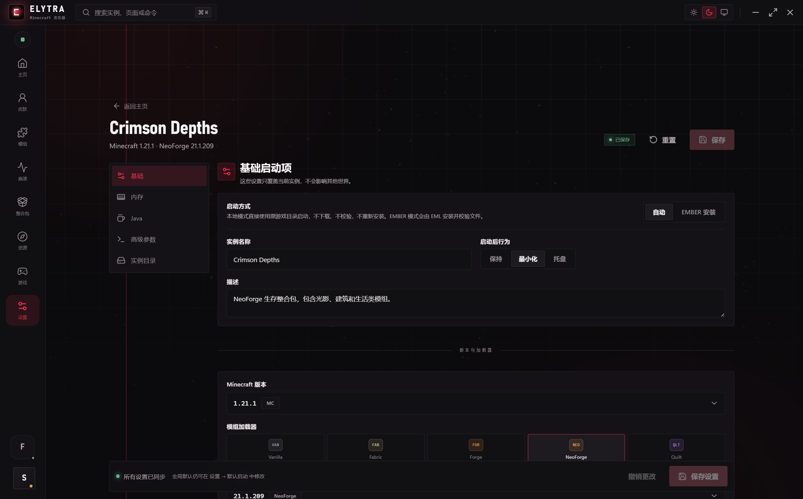 | 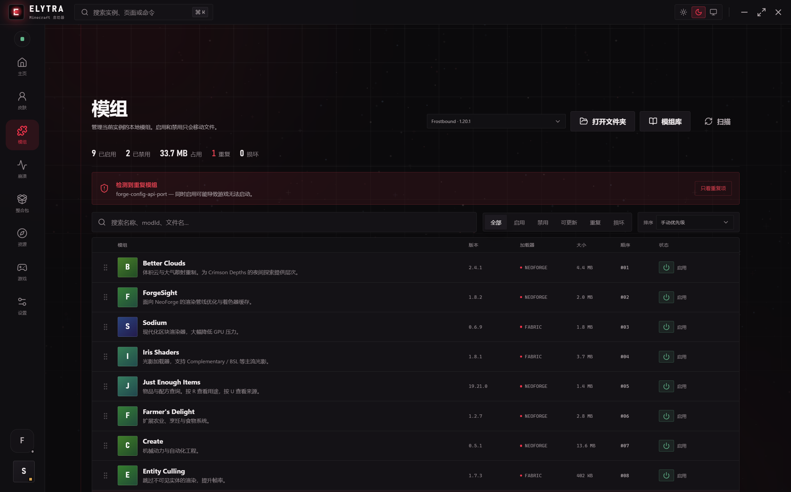 |

| 本地直接启动 | 加载已有游戏 |
| --- | --- |
| 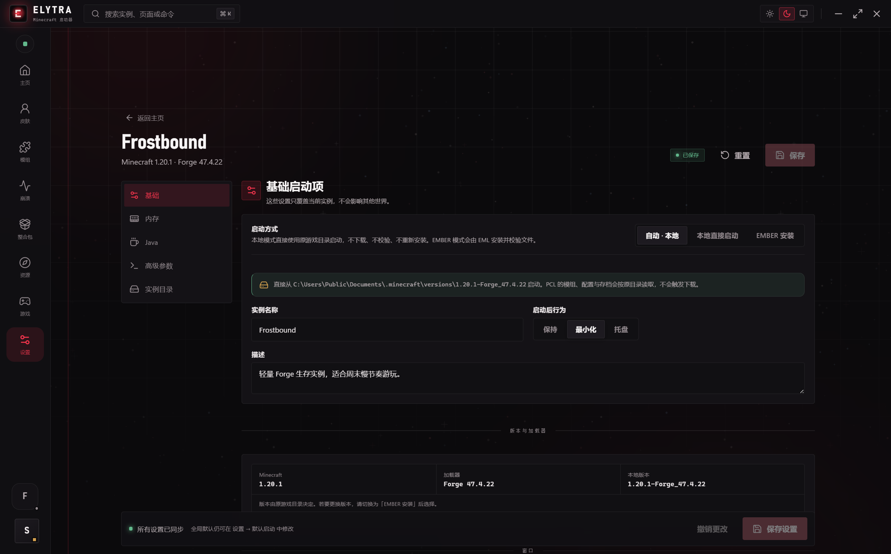 | 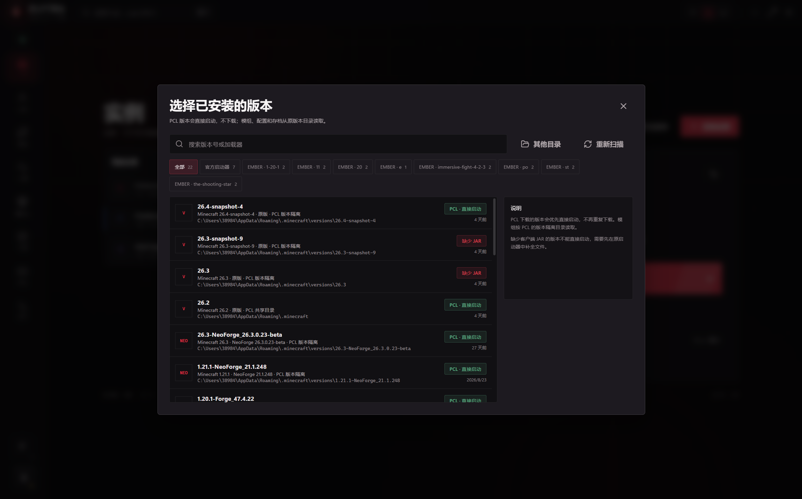 |

| 崩溃分析 | 皮肤 |
| --- | --- |
| 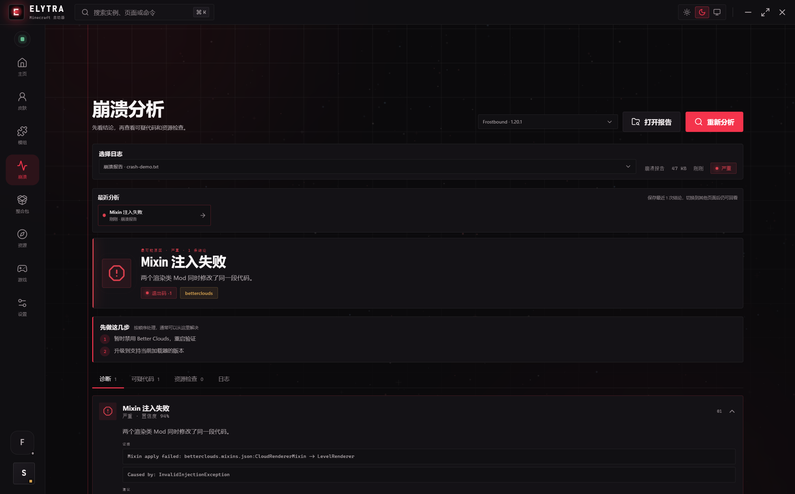 | 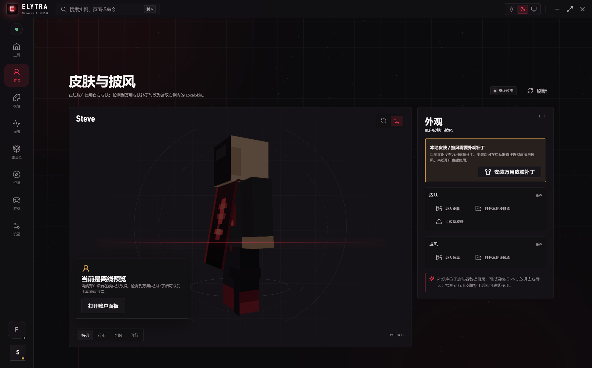 |

| 浅色主题 | 启动面板 |
| --- | --- |
| 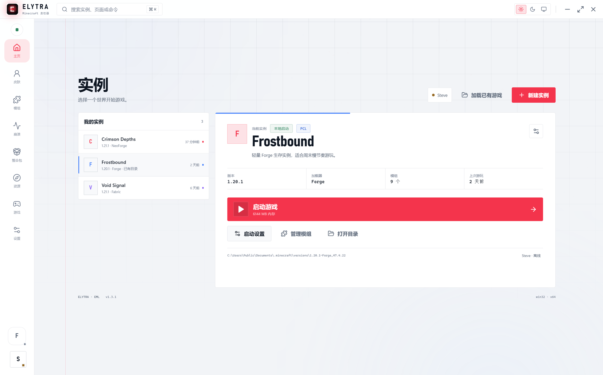 | 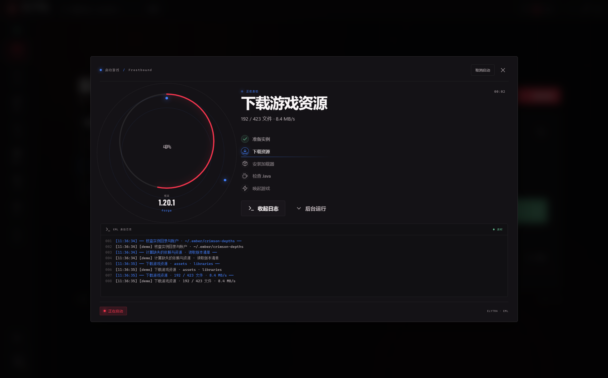 |

| 账户 | 整合包 |
| --- | --- |
| 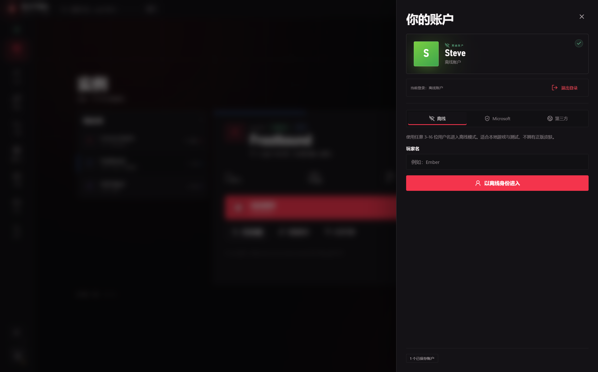 | 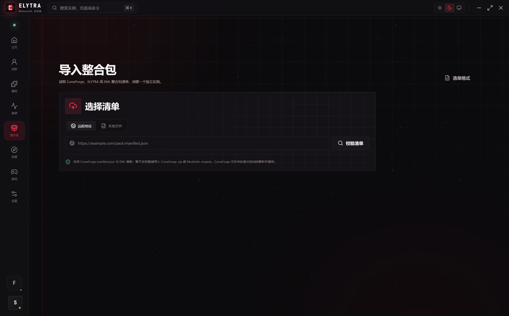 |

| 统一游戏设置 | 下载优化 |
| --- | --- |
| 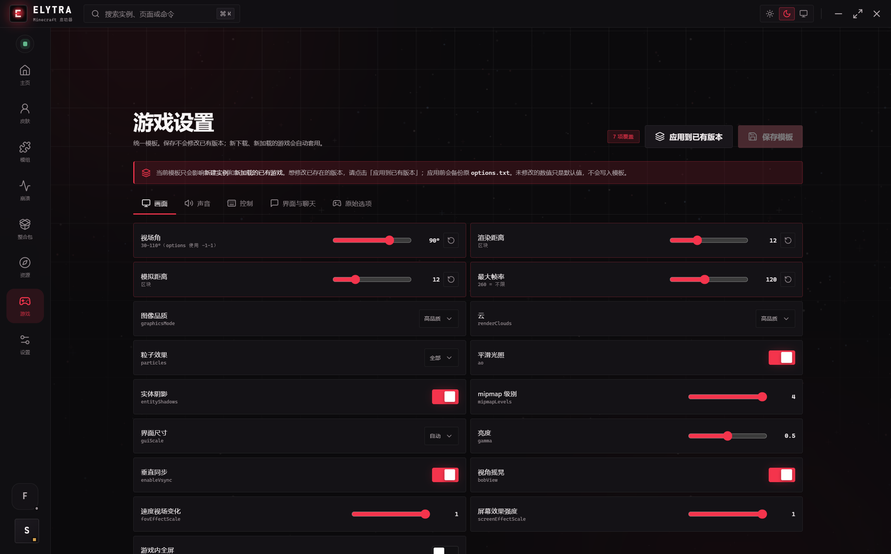 | 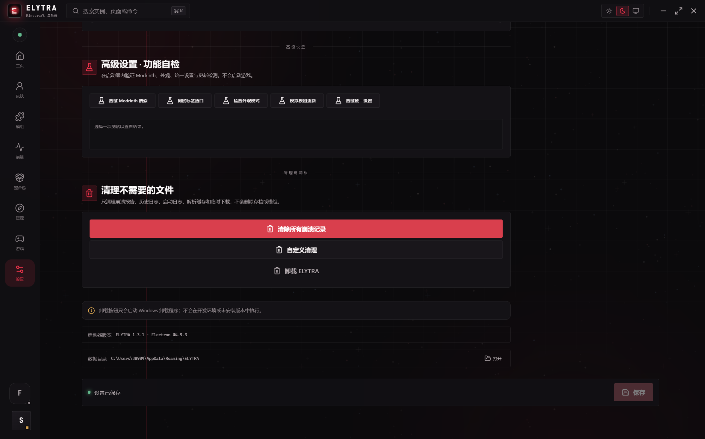 |

| Modrinth 资源 | 本地皮肤 / 披风 |
| --- | --- |
| 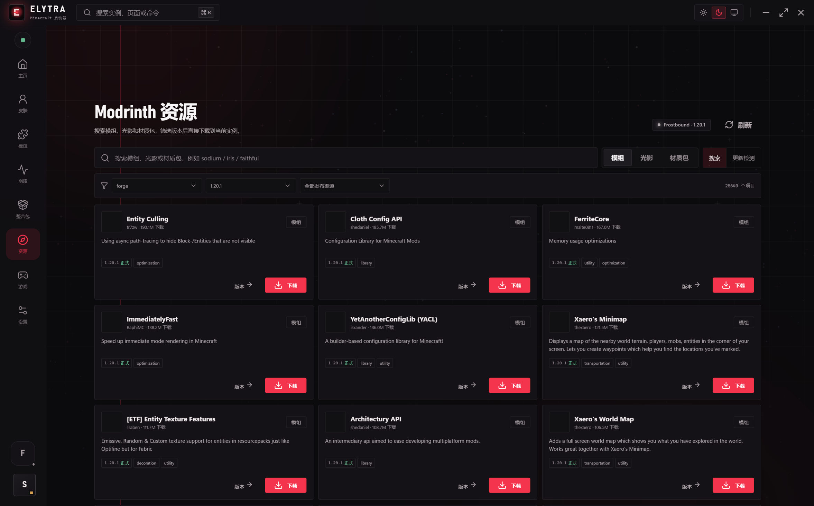 | 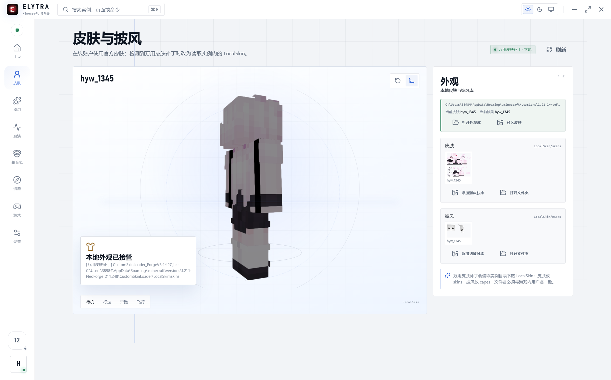 |

| 外观库 | 定时主题 |
| --- | --- |
|  | 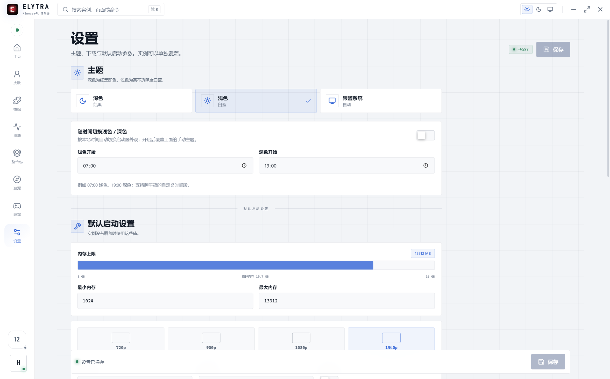 |

---

Minecraft is a trademark of Mojang Studios. EML Lib is licensed under MIT. 本项目仅用于个人学习与自用。
